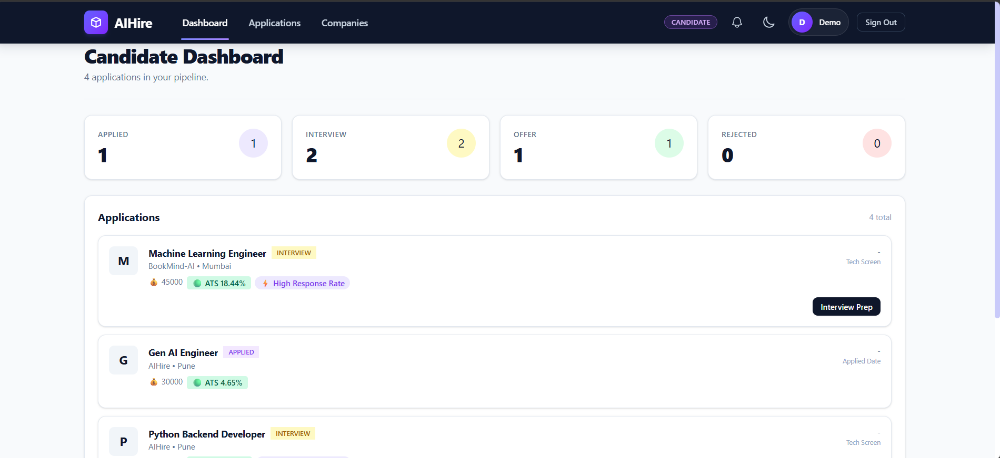

# AIHire

**AI-powered recruitment and interview-preparation platform.**

Candidates build a profile, upload a resume and get a real ATS match score against every job; recruiters post jobs and work an application pipeline with ranked applicants; everyone can practise with an AI mock interview that grades their answers and returns actionable feedback.

- **Backend** — FastAPI · SQLAlchemy 2.0 · Alembic · PostgreSQL · JWT auth
- **Frontend** — React 19 · Vite · Tailwind CSS 4 · React Router 7 · Recharts
- **AI** — SkillNER/spaCy resume parsing & ATS scoring, LLM-backed (Gemini) interview engine with a rule-based fallback



---

## Table of contents

1. [Features](#features)
2. [Project structure](#project-structure)
3. [Prerequisites](#prerequisites)
4. [Backend setup](#backend-setup)
5. [Frontend setup](#frontend-setup)
6. [How the AI pieces work](#how-the-ai-pieces-work)
7. [API reference](#api-reference)
8. [Frontend routes](#frontend-routes)
9. [Verification scripts](#verification-scripts)
10. [Deployment notes](#deployment-notes)
11. [Troubleshooting](#troubleshooting)

---

## Features

### Candidate
- Register / login, editable profile (headline, bio, skills, experience, education).
- **Resume library** — upload multiple PDF/DOCX resumes; text is extracted and skills are extracted with a spaCy + SkillNER pipeline.
- **ATS scoring** — each resume is scored against a job's required skills (0–100) plus a per-job match with missing-skill breakdown.
- **Job discovery** — search/filter the job board, one-click apply with a cover letter; re-applying is allowed after a rejection.
- **Recommendations** — ranked job suggestions with match percentage and missing skills.
- **Mock interview** — choose a role/skill focus, answer generated questions (≈70% technical / 30% behavioural), get an overall score, per-question breakdown, strengths and improvements, plus full history.
- **Application tracking** — watch your status move through `applied → shortlisted → interview → selected / rejected`.
- **Notifications** — in-app feed with unread badge and mark-read / mark-all-read.

### Recruiter
- Company profile (company name, designation, company description) with create / fetch / upsert endpoints.
- Job CRUD (title, skills, salary, experience, job type, deadline, active flag) — posting a job notifies matching candidates.
- **Pipeline view** — applicants ranked by ATS score, applicant detail modal with parsed skills and resume analysis.
- **Bulk actions** — move many applications to a stage in one request; repeated requests don't re-notify.
- Application status changes notify the candidate in real time.
- Analytics charts (recharts) on the recruiter dashboard.

### Admin
- Dashboard stats, user management (activate/deactivate), all jobs, all interviews.
- Admin accounts are **not** creatable through the public register endpoint — seed them with `scripts/seed_admin.py`.

---

## Project structure

```
AIHire/
├── backend/
│   ├── alembic/                 # migrations (versions/)
│   ├── app/
│   │   ├── api/                 # FastAPI routers: auth, job, application,
│   │   │                        #   interview, notification, admin,
│   │   │                        #   candidate_profile, recruiter_profile
│   │   ├── core/                # config (pydantic-settings), security (JWT)
│   │   ├── database/            # engine + session factory
│   │   ├── models/              # SQLAlchemy models
│   │   ├── repositories/        # data access / queries
│   │   ├── schemas/             # Pydantic request/response models
│   │   ├── services/            # business logic
│   │   └── utils/               # ATS analyzer, interview engines, LLM client
│   ├── scripts/                 # seed_admin + verification scripts
│   ├── uploads/resumes/         # uploaded resumes (git-ignored)
│   └── requirements.txt
├── frontend/
│   ├── src/
│   │   ├── api/client.js        # axios instance (base URL)
│   │   ├── components/          # Navbar, ui/ (cards, tables, modals, …)
│   │   ├── context/             # AuthContext, ThemeContext (dark mode)
│   │   ├── pages/               # Login, Register, Candidate/Recruiter dashboards,
│   │   │                        #   Applications, Companies, Interview, Admin, Home
│   │   └── utils/               # role helpers, interview state helpers
│   └── scripts/                 # node verification scripts
└── design.png                   # UI design reference
```

---

## Prerequisites

| Tool | Version |
| --- | --- |
| Python | 3.10+ |
| Node.js | 18+ (20+ recommended) |
| PostgreSQL | 14+ |
| Git | any recent |

---


## Backend setup

Run all commands from `backend/`.

```bash
cd backend

# 1. Virtual environment
python -m venv venv
source venv/bin/activate          # macOS/Linux
# venv\Scripts\activate           # Windows PowerShell

# 2. Dependencies
pip install -r requirements.txt

# 3. spaCy model (used by the skill extractor — required)
python -m spacy download en_core_web_sm

# 4. Create the database, then migrate
#    (create the DB first: createdb aihire, or use pgAdmin/psql)
alembic upgrade head

# 5. Seed the admin account (idempotent — safe to re-run)
python scripts/seed_admin.py
# reset later with: python scripts/seed_admin.py --reset-password "YourNewStrongPassword"

# 6. Run
uvicorn app.main:app --reload
```

API is now on **http://127.0.0.1:8000** — interactive docs at **http://127.0.0.1:8000/docs**.

### Migrations included

| Revision | Purpose |
| --- | --- |
| `86903f449da0` | initial schema |
| `7e031afd7fb1` | candidate & recruiter profile fields |
| `59bdf19fec7c` | `ats_score` on applications |
| `a1b2c3d4e5f6` | reconcile schema (job metadata, resume parsed data, `interview_sessions`, `recommendations`) |
| `b2c3d4e5f6a7` | allow jobless (practice) interviews |
| `c7d8e9f0a1b2` | persist interview questions |
| `f6ac375b0143` | notifications table |

---

## Frontend setup

Run from `frontend/`.

```bash
cd frontend

npm install
npm run dev          # http://localhost:5173
```

Other scripts:

```bash
npm run build        # production bundle -> dist/
npm run lint         # ESLint
npm run preview      # serve the production build
node scripts/verify-interview-state.mjs
node scripts/verify-interview-textarea.mjs
```

The API base URL is set in **`src/api/client.js`** (`http://127.0.0.1:8000`) — change it for production.

**Start order:** backend on `:8000` first, then the frontend. The backend CORS policy only allows `http://localhost:5173` and `http://127.0.0.1:5173`.

---

## How the AI pieces work

### Resume analysis & ATS score
1. PDF/DOCX text is extracted with `pdfplumber` / `python-docx`.
2. Skills are extracted with spaCy (`en_core_web_sm`) + the SkillNER skill database (`skill_db_relax_20.json`), with a case-insensitive matching pass.
3. `calculate_ats_match(candidate_skills, job.required_skills)` returns a 0–100 score used both for the resume analysis view and for ranking applicants.

### Mock interview engine
Two engines with **identical signatures and return shapes**, so the service layer can swap them transparently:

| | Rule-based (default) | LLM-backed |
| --- | --- | --- |
| Enabled by | always available | `LLM_ENABLED=true` + `LLM_API_KEY` |
| Questions | template/keyword driven | Gemini via LangChain structured output |
| Grading | keyword scoring | model graded, then re-keyed to the real question ids |
| Failure | n/a | raises `LLMUnavailableError` → **falls back to the rule-based engine** |

- Question mix is ~70% technical / 30% behavioral, capped by `LLM_MAX_QUESTIONS`.
- `strengths` and `improvements` are returned as `"; "`-joined strings — the UI calls `.split("; ")` on them.
- Both engines treat profile/answer text as **data, not instructions** (prompt-injection hardening).

---

## API reference

All routes are prefixed as shown; authenticated routes expect `Authorization: Bearer <access_token>`.

### Auth — `/auth`
| Method | Path | Description |
| --- | --- | --- |
| POST | `/auth/register` | Register (admin role blocked) |
| POST | `/auth/login` | OAuth2-style login, returns JWT |
| GET | `/auth/me` | Current user |

### Jobs — `/jobs`
| Method | Path | Description |
| --- | --- | --- |
| POST | `/jobs` | Create job (recruiter) — notifies candidates |
| GET | `/jobs` | Search/list active jobs |
| GET | `/jobs/{job_id}` | Job detail |
| GET | `/jobs/recruiter/me` | My posted jobs |
| PUT | `/jobs/{job_id}` | Update job |
| DELETE | `/jobs/{job_id}` | Deactivate/delete job |

### Applications
| Method | Path | Description |
| --- | --- | --- |
| POST | `/jobs/{job_id}/applications` | Apply (candidate) |
| GET | `/jobs/{job_id}/applications/ranked` | Applicants ranked by ATS score |
| PATCH | `/jobs/{job_id}/applications/bulk-status` | Bulk status update |
| GET | `/applications/recruiter` | All my pipeline rows |
| GET | `/applications/me` | My applications |
| GET | `/applications/{id}/details` | Applicant details for recruiter |
| PATCH | `/applications/{id}/status` | Move one application (notifies candidate) |

### Candidate profile — `/candidate-profile`
| Method | Path | Description |
| --- | --- | --- |
| GET / PUT | `/candidate-profile/me` | Read / update profile |
| POST | `/candidate-profile` | Create profile |
| GET | `/candidate-profile/recommendations` | Ranked job recommendations |
| POST | `/candidate-profile/resume` | Upload resume |
| GET | `/candidate-profile/resume/{resume_id}` | Resume + parsed data |
| GET | `/candidate-profile/resume/{resume_id}/analysis` | ATS analysis |

### Recruiter profile — `/recruiter-profile`
| Method | Path | Description |
| --- | --- | --- |
| POST | `/recruiter-profile` | Create company profile |
| GET / PUT | `/recruiter-profile/me` | Read / upsert company profile |

### Interviews — `/interviews`
| Method | Path | Description |
| --- | --- | --- |
| POST | `/interviews/questions` | Generate a question set |
| POST | `/interviews/evaluate` | Grade answers → score + feedback |
| GET | `/interviews/history` | Past sessions |
| GET | `/interviews/{interview_id}` | Session detail (questions + results) |

### Notifications — `/notifications`
| Method | Path | Description |
| --- | --- | --- |
| GET | `/notifications` | Feed (default 20) |
| GET | `/notifications/unread-count` | Badge count |
| POST | `/notifications/{id}/read` | Mark one read |
| POST | `/notifications/read-all` | Mark all read |

### Admin — `/admin`
| Method | Path | Description |
| --- | --- | --- |
| GET | `/admin/dashboard-stats` | Platform metrics |
| GET | `/admin/users` | All users |
| POST | `/admin/users/{id}/toggle-active` | Activate/deactivate user |
| GET | `/admin/jobs` | All jobs |
| GET | `/admin/interviews` | All interview sessions |

---

## Frontend routes

| Path | Page | Access |
| --- | --- | --- |
| `/` | Landing page | public |
| `/register`, `/login` | Auth (redirect if logged in) | public-only |
| `/candidate` | Candidate dashboard | candidate |
| `/applications` | My applications | candidate |
| `/companies` | "Companies Hiring" job board — search, location filter, one-click apply | sign-in required |
| `/interview` | Mock interview (setup → active → result → history) | candidate |
| `/recruiter` | Recruiter dashboard (jobs, pipeline, analytics) | recruiter |
| `/admin` | Admin console (users, jobs, interviews) | admin |
| `*` | Catch-all redirect | — |

Role helpers live in `src/utils/roles.js`; protected/public-only route guards are in `src/App.jsx`.

---

## Verification scripts

Backend (run from `backend/` with the venv active):

```bash
python scripts/verify_engine_flag.py        # engine selection flag
python scripts/verify_llm_contract.py       # LLM response shape contract
python scripts/verify_endpoint_engine.py    # endpoint -> engine wiring
python scripts/verify_tamper.py             # prompt-injection resistance
python scripts/compare_engines.py           # rule-based vs LLM outputs
python scripts/diagnose_quality.py          # question quality diagnostics
python scripts/check_llm_live.py            # live API smoke test (needs key)
python scripts/verify_e2e_live.py           # end-to-end live flow (needs key)
```

Frontend (run from `frontend/`):

```bash
node scripts/verify-interview-state.mjs
node scripts/verify-interview-textarea.mjs
```

---

## Deployment notes

Before shipping to production:

1. **Push your work** — keep `origin/main` in sync with local commits.
2. **CORS** — `backend/app/main.py` currently allows only `http://localhost:5173`; add your deployed frontend origin.
3. **API base URL** — update `frontend/src/api/client.js` (currently hardcoded to `http://127.0.0.1:8000`), or make it read `import.meta.env.VITE_API_URL`.
4. **Database** — run `alembic upgrade head` against the production DB and seed the admin: `python scripts/seed_admin.py`.
5. **Secrets** — set `DATABASE_URL`, `JWT_SECRET_KEY`, `LLM_API_KEY` in the host's environment, never in the repo.
6. **Frontend build** — `npm run build`, serve `dist/` (Vercel/Netlify/nginx) and point the build at the real API origin.
7. **Uploads** — persist `backend/uploads/` (or switch to object storage); the directory is git-ignored.
8. **Smoke test from a clean clone**: install → migrate → seed → run both apps → log in as candidate, recruiter and admin.

Typical split: backend on Render/Railway/Fly (`uvicorn app.main:app --host 0.0.0.0`), frontend on Vercel/Netlify, managed PostgreSQL.

---

## Troubleshooting

| Symptom | Fix |
| --- | --- |
| `ModuleNotFoundError: en_core_web_sm` | `python -m spacy download en_core_web_sm` |
| `Settings() missing DATABASE_URL / JWT_SECRET_KEY` | `.env` must be at the **repo root**, one level above `backend/` |
| CORS error in the browser | Frontend must run on `:5173`, or add your origin to `allow_origins` |
| `relation ... does not exist` | `alembic upgrade head` on the database in `DATABASE_URL` |
| Interview requests are slow | Use `LLM_MODEL=gemini-3.5-flash-lite`, or set `LLM_ENABLED=false` for the rule-based engine |
| 500 on interview endpoints with LLM on | Check `LLM_API_KEY`; the service automatically falls back to the rule-based engine |
| Login works but every route redirects | Token not stored — check `Authorization` header in `src/api/client.js` interceptors |

---


